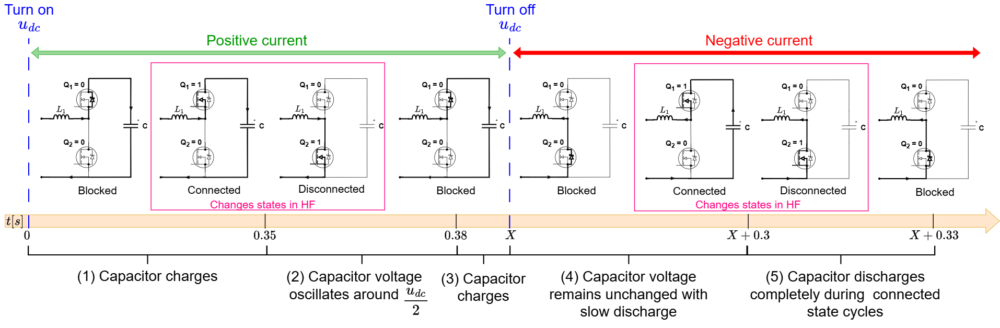
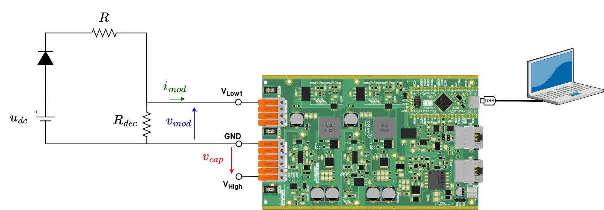
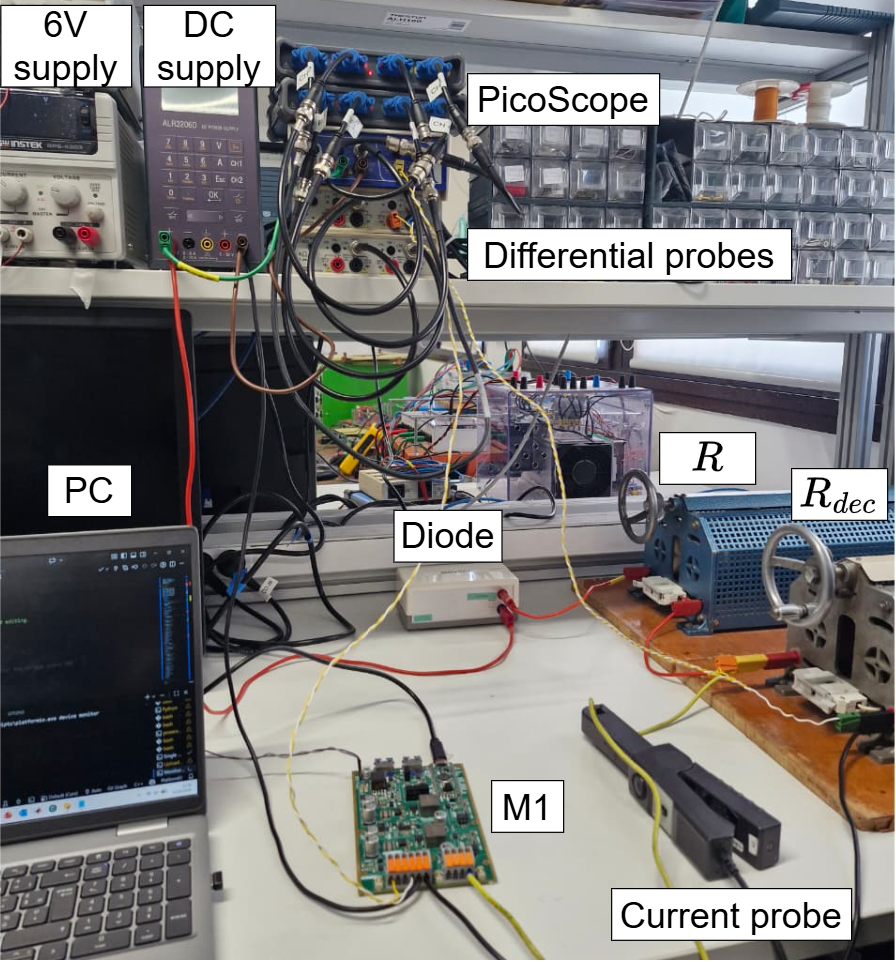
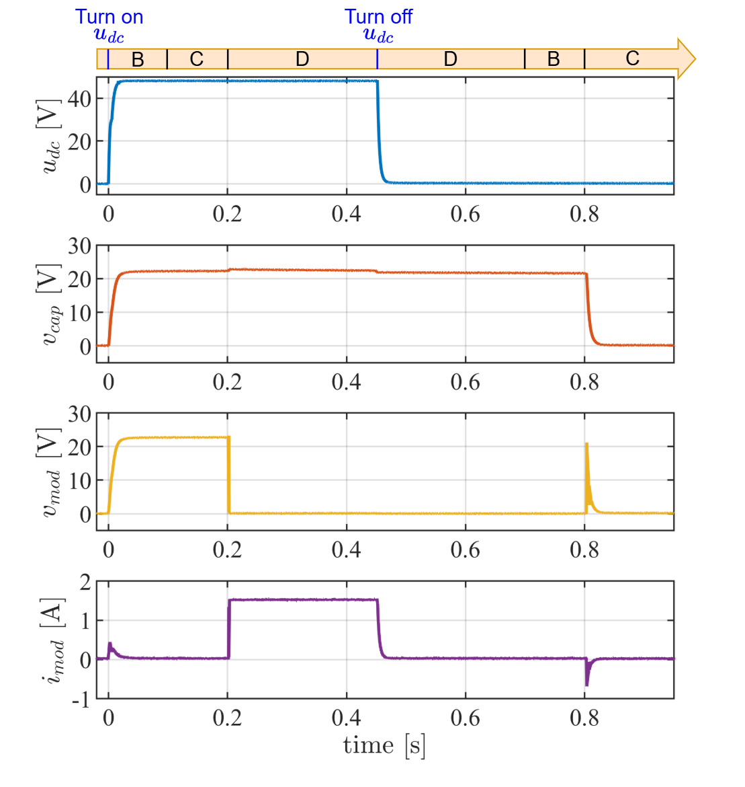
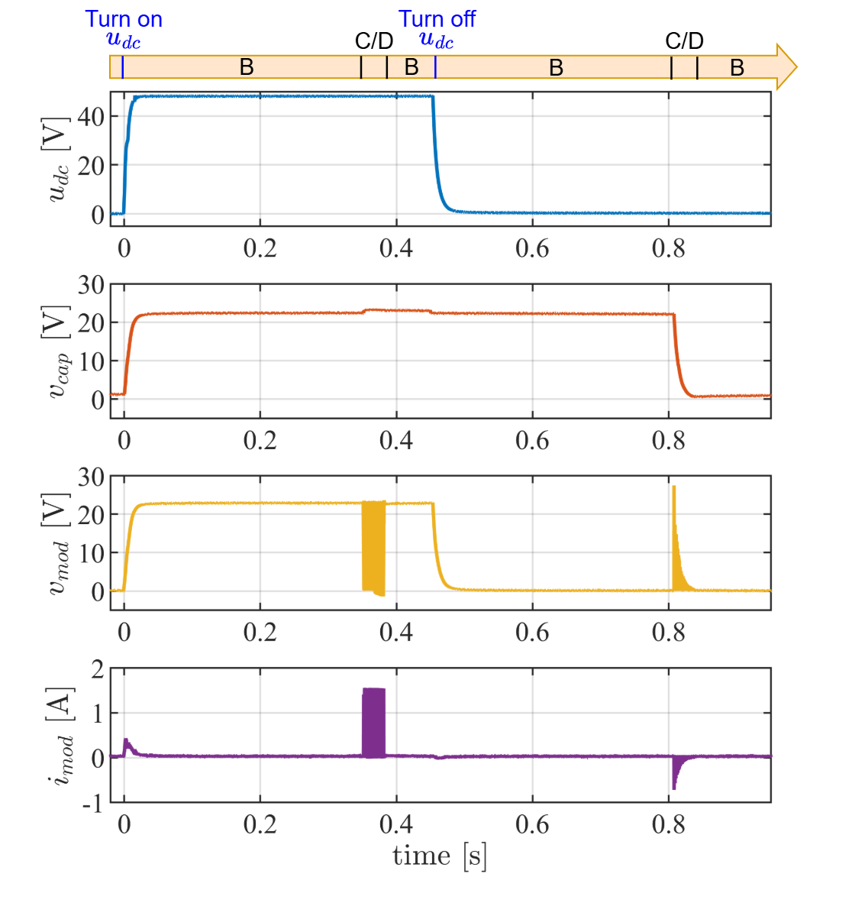

# MMC module test sequences

Remark: The difference between this test and the original module tests of previous versions is that the code was modified to no longer need programmable DC power supply.

## Objectives and context

The goal of this tutorial is to test a individual MMC module operation in all its states in both low and high frequency. For that, we used the circuit structure below. R_{dec} resistance is connected in parallel to the module in order to emulated negative currents discharging the module capacitor.

The board serves as a HB module of the MMC by programming its second leg (LEG2) to be deactivated, having the following circuit. Observe that the HIGH terminals are open (Vhigh to GND).

The tutorial will consist of putting the module M1 in Disconnected, Connected and Blocked states according to the correspondence table below:

| State | $i_{mod}$ | $Q1$ | $Q2$ | $Q3$ | $Q4$ | $Q5$ | $Q6$ | $v_{mod}$ |
| --- | --- | --- | --- | --- | --- | --- | --- | --- |
| Connected (C) | +/- | <code style="color : green">Closed</code> | <code style="color : red">Open</code> | <code style="color : red">Open</code> | <code style="color : red">Open</code> | <code style="color : red">Open</code> | <code style="color : red">Open</code> | $+v_{cap}$ |
| Disconnected (D) | +/- | <code style="color : red">Open</code> | <code style="color : green">Closed</code>  | <code style="color : red">Open</code> | <code style="color : red">Open</code> | <code style="color : red">Open</code> | <code style="color : red">Open</code> | $0$ |
| Blocked (B) | - | <code style="color : red">Open</code> | <code style="color : red">Open</code> | <code style="color : red">Open</code> | <code style="color : red">Open</code> | <code style="color : red">Open</code> | <code style="color : red">Open</code> | $+v_{cap}$ |
| Blocked (B) | + | <code style="color : red">Open</code> | <code style="color : red">Open</code> | <code style="color : red">Open</code> | <code style="color : red">Open</code> | <code style="color : red">Open</code> | <code style="color : red">Open</code> | $0$ |

The module state is controlled using the board first leg (LEG1) switches Q1 and Q2 command:

Connected state:
- $Q1$ MOSFET is <code style="color : green">Closed</code> and $Q2$ MOSFET is <code style="color : red">Open</code>.
- The module is said to be connected to the circuit, contributing to the stack with its capacitor voltage and the current pass through its capacitor.

Disconnected state:
- $Q1$ MOSFET is <code style="color : red">Open</code> and $Q2$ MOSFET is <code style="color : green">Closed</code>.
- The module is said to be bypassed from the circuit, so it does not contribute to the stack voltage and no current pass through its capacitor.

Blocked state:
- $Q1$ MOSFET is <code style="color : red">Open</code> and $Q2$ MOSFET is <code style="color : red">Open</code>.
- Since both MOSFETs are open, only anti-parallel diodes conducts. Which diodes conducts will depend only if current sign is positive or negative.

## Test sequences

The module test passes by two sequences: a low-frequency sequence (f<10 Hz) and a high-frequency sequence.

- The low-frequency sequence objective is to verify if the TWIST/SPIN board is correctly programmed and behaves like a half-bridge module (with three states: connected, disconnected, and blocked). The figure below shows the complete low-frequency sequence. The turn on of the DC voltage $u_{dc}$ sets the start of the sequence "positive current" step. In this step, the current flows only in the positive sense of $i_{mod}$. After this first step is completed, the user has to manually turn off $u_{dc}$ supply to start the "negative current" step. The start of the "negative current" step is noted by the X moment in the timeline. During this step, as the left side ($u_{dc}$ and resistors) of the circuit has lower voltage than the capacitor, the current can only flow in the negative sense of $i_{mod}$. This will enable to observe the capacitor discharge.

- The high-frequency sequence objective is to verify if the module is able to operate at higher switching frequencies, ranging from 50 Hz (corresponding to NLM operation) up to the kHz range (PWM). Both sequences tests the three states with both positive and negative current. The figure below shows the complete high-frequency sequence. As for the low-frequency sequence, a positive and negative current steps are defined according to the turn on and turn off moment of $u_{dc}$. Intead of keeping the module at one state, the high-frequency sequence alternates the module between connected and disconnected states at the target switching frequency to observe its behavior while switching.

Reminder: The user must manually TURN ON the udc power supply to start the sequence first part (positive current) and also TURN OFF udc to start the sequence second part (negative current).

## Required Hardware list:
- 1 TWIST boards with SPIN
- DC Power Supply (48 V, 2 A)
- Protection diode (at least 50 V)
- 2 resistors of 30 $\Omega$
- PC 64-bits (windows or linux)
- Oscilloscope
- Current probe
- 2 BNC adaptors to differential voltage measurement or differential probes

## Required Software list:
- Git
- Visual Studio Code with PlatformIO

If not done yet, you should do the [Getting started tutorial on how to setup VScode for OwnTech usage](../../../MMC_documentation/Getting%20started/Vscode_for_OwnTech_configuration.md).

## Get tutorial code from VScode

First, we need to load the Single module test code from the OwnTech example repository version in https://github.com/analuhaas/examples 
1.	In VScode, open the folder where you previously cloned OwnTech’s github.
2.	In platformio.ini file, substitute the owntech_examples variable link by https://github.com/analuhaas/examples.git 
3.	Click on platform.io icon , go to Examples Twist under the Project Tasks tab and click on “MMC module test sequence”. Now you have the good code to execute the tutorial in your VScode.

## Minor hardware modifications and calibration

Repeat for the stack modules boards, if not done yet:

4.	Recommended for a typical MMC behavior: Configure all 5 modules boards with the minor hardware modifications indicated in the [tutorial](../../../MMC_documentation/Prototype%20tutorials/twist_modifications_MMC_tutorial.md).

5.  Calibrate the module sensors as explained in the [tutorial](../../../MMC_documentation/Prototype%20tutorials/twist_calibration_tutorial.md).

## Module hardware setup

6.	Connect the module to an External Auxiliary DC Power Supply to the TWIST via the 6 V and 6VGND PINs. Make sure the External Auxiliary DC Power Supply is configured to deliver 6 V with limiting current above 0.5 A. Make sure these power supplies OUTPUT IS OFF.
7.	Connect the board with the power supply, the R and Rdec resistances and PC as in the image: 

8.	Connect the oscilloscope to measure: module capacitor voltage $v_{cap}$, module voltage $v_{mod}$ and current $i_{mod}$, and DC voltage $u_{dc}$.

After making the connections and connecting the PC to board the USB-C cable, you should have something like this:

9.	Configure your Oscilloscope. Recommended configurations are:
- 200 ms/div configuration with sampling interval around 1 µs (x5 smaller than critical task period)
- Trigger when the stack voltage rises up to 2 V.

## Executing the LF module test

10.	Verify you got correct test code using “MMC module test sequence” button.
11.	Set the "SEQUENCE" variable to "LF".
12.	Build  and Upload  the code main.cpp into the board.
13.	Make sure the 6 V External Auxiliary DC Power Supply is configured to deliver 6 V with limiting current above 0.5 A. TURN ON the External Auxiliary DC Power Supply output.

The boards starts in IDLE mode (equal to module blocked state).
14.	TURN ON the main power supply output. This will start the sequence first part (positive current).
15.	After you verify the first sequence part is finished (after 0.5 s), TURN OFF the main power supply output. This will start the sequence second part.
16.	Save your oscilloscope data.

## Stopping tutorial

17.	TURN OFF the 6V External Auxiliary DC Power Supply output.

## Expected results for the LF module test

In the low-frequency sequence, the module expected behavior is as shown in the figure below if you perform the minor hardware modifications recommended for MMC usage:

## Executing the HF module test

10.	Verify you got correct test code using “MMC module test sequence”  button.
11.	Set the "SEQUENCE" variable to "HF".
12.	Build  and Upload  the code main.cpp into the board.
13.	Make sure the 6 V External Auxiliary DC Power Supply is configured to deliver 6 V with limiting current above 0.5 A. TURN ON the External Auxiliary DC Power Supply output.

The boards starts in IDLE mode (equal to module blocked state).
14.	TURN ON the main power supply output. This will start the sequence first part (positive current).
15.	After you verify the first sequence part is finished (after 0.5 s), TURN OFF the main power supply output. This will start the sequence second part.
16.	Save your oscilloscope data.

## Stopping tutorial

17.	TURN OFF the 6 VExternal Auxiliary DC Power Supply output.

## Expected results for the HF module test

In the high-frequency sequence, the module expected behavior is as shown in the figure below if you perform the minor hardware modifications recommended for MMC usage:

