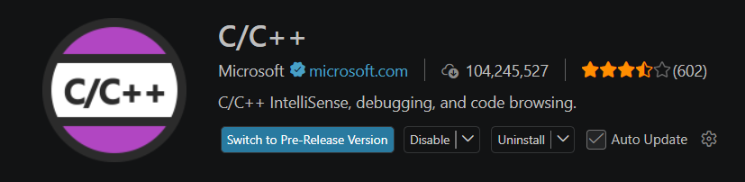
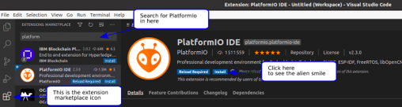
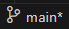
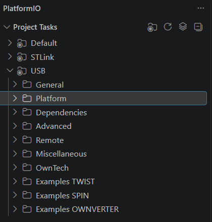

# Necessary initial Github/VSCode configuration

## Pre-installation requirements		

1) Git ⚠ : Make sure Git is installed on your computer. You can use one of the following links to install it: https://git-scm.com/book/en/v2/Getting-Started-Installing-Git . If you are on Windows, go directly to this one: https://gitforwindows.org/GitForWindows

2) Python : Ensure that Python (version 3 or higher) is installed on your machine. https://www.python.org/								

3) CMake : Make sure CMake is installed on your machine. https://cmake.org/download/								

4) Install Visual Studio Code : Download Visual Studio Code from https://code.visualstudio.com/. It will offer the appropriate version based on your operating system.								

5) In Vscode, install C/C++ extension
   
  5a) Launch Visual Studio Code.		
  
  5b) In the sidebar, click the Extensions icon 
  
  5c)  In the search bar, type “C/C++”, then click Install.				
  
  5d) After installed, restart Visual Studio Code.				

6) Install de PlatformIO extension								

6a) Launch Visual Studio Code.				

6b) In the left-hand menu, click on the Extensions icon 

6c)  In the search bar, type “PlatformIO IDE,” then click Install				

6d) After installed, restart Visual Studio Code.				

## Configuring PlatformIO to have access to Owntech's examples

7) In Visual Studio Code, in the side menu, click on the PlatformIO icon 
								

8) In PlatformIO, select Clone Git Project. PlatformIO will open a field where you can paste the following URL: https://github.com/owntech-foundation/Core.git .PlatformIO will ask where to clone the project. Choose a folder you previously created.								
> The cloned project's path must not contain spaces. If your Windows username contains spaces, try the following steps:
> -	Uninstall PlatformIO from VS Code
> - Set a new Windows environment variable to avoid spaces by running the following command in Command Prompt as Administrator:
>setx PLATFORMIO_CORE_DIR "C:\PlatformIO"
> -	Reinstall PlatformIO in VS Code.

9) Make sure you’re on the main branch of the Git project in the bottom-left corner of Vscode window. 
						
10) Also check that you're in the PlatformIO section and that the Project Tasks have correctly updated with the folders: Owntech, Examples TWIST, and Examples SPIN.
-	In the Examples TWIST folder, you’ll find various examples of configurations for the power circuits.
-	In the Examples SPIN folder, you’ll find various examples of configurations of the main functions of the SPIN control board.								

## Configuring GitHub connection with Vscode

11) Install Git graph in VScode.

12) Follow this tutorial to create a SSH key and add it to your GitHub account: https://medium.com/@techworldthink/a-beginners-guide-to-adding-ssh-key-to-github-windows-6a5de5396ba6 								

>  	If your PC user is not administrator, you will need to modify the file in which you will save the SSH key in Step1 of the SSH tutorial.
>Enter file in which to save the key (C:\Users\admin/.ssh/id_rsa): C:\Users\your-user-name/.ssh/id_rsa.
>Then, you will probably have this warning when trying to follow Step 3 in the tutorial:
>
>@@@@@@@@@@@@@@@@@@@@@@@@@@@@@@@@@@@@@@@@@@@@@@@@@@@@@@@@@@@
>@         WARNING: UNPROTECTED PRIVATE KEY FILE!          @
>@@@@@@@@@@@@@@@@@@@@@@@@@@@@@@@@@@@@@@@@@@@@@@@@@@@@@@@@@@@
>Permissions for 'C:\\Users\\your-user-name/.ssh/id_rsa' are too open.
>It is required that your private key files are NOT accessible by others.
>
>   This should concern you if you share your PC with other people, if it is the case, you should get in touch with the IT team of the lab.
