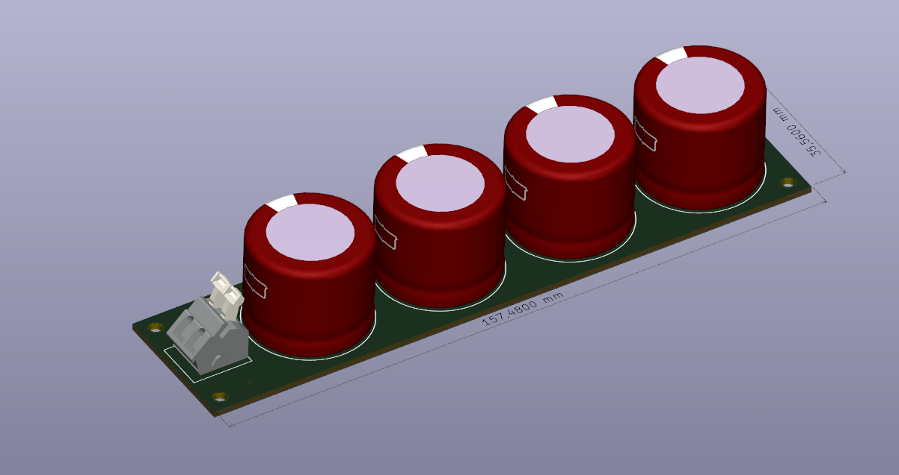
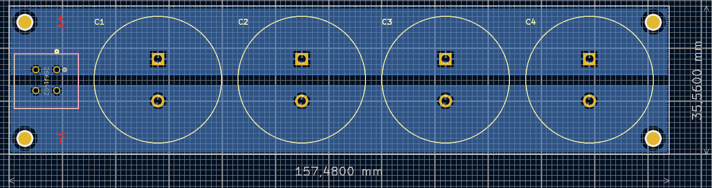

# Module capacitor extension board (KiCad project)

This KiCad project is an extension board used to increase the capacitance of an MMC module built with a TWIST board. It is connected in parallel to the module capacitor $C_{High}$ through the VHigh and GND terminals of the TWIST board.

The TWIST high-side capacitor $C_{High}$ (188.6 µF) is used as the module capacitor, but it is too small to sustain the energy needed for operation at 50 Hz: the capacitors charge and discharge too fast, which increases the voltage ripple and deforms the stack voltage. The reasons and the impact on the stack behavior are explained in the [TWIST modifications for MMC tutorial](../twist_modifications_MMC_tutorial.md).

## Board description

The board holds up to 4 electrolytic capacitors in parallel (C1 to C4) and a 2-pole terminal block (J1) to connect it to the module:

| Reference | Component | Quantity | Supplier reference |
|---|---|---|---|
| C1, C2, C3, C4 | Electrolytic capacitor 560 µF, 250 V, CHEMI-CON LXS series (`ELXS251VSN561MR25S`) | 4 | RS Components 914-3692 |
| J1 | 2-pole PCB terminal block (`1715721`) | 1 | [RS Components 193-0564](https://fr.rs-online.com/web/p/embases-circuits-imprimes/1930564) |

- **Board size:** 157.48 mm × 35.56 mm.
- **Terminals:** J1 has a V+ pin, to connect to **VHigh**, and a V− pin, to connect to **GND** of the TWIST board.
- **Mounting:** 4 holes of 3 mm at the corners, used to stack several extension boards with spacers.

With the 4 capacitors mounted, the board adds $4 \times 560 = 2240$ µF in parallel to $C_{High}$, giving about 2430 µF per module.

!!! warning Polarity and voltage
    Respect the polarity of the electrolytic capacitors and of the connection (V+ to VHigh, V− to GND). Make sure the capacitor voltage rating is above the maximum module capacitor voltage of your test.

If you use other capacitors, adapt the size and spacing of the capacitor holes (footprint `CAPPRD1000W180D3050H2750`) on the PCB.

## Usage in the prototype

One extension board is connected to each module of the stack, using cables between its terminal block and the VHigh and GND terminals of the module. The boards of a stack can be piled up, forming a tower beside the stack:

## Project files

The project is in the [Condensateur_Ana251211](Condensateur_Ana251211) folder:

| File / folder | Content |
|---|---|
| `Condensateur_Ana_251210.kicad_pro` | KiCad project (open this file with KiCad) |
| `Condensateur_Ana_251210.kicad_sch` | Schematic |
| `Condensateur_Ana_251210.kicad_pcb` | PCB layout |
| `Symbole/`, `Footprint/` | Project symbol and footprint libraries (capacitor and terminal block) |
| `Composants/` | Downloaded component libraries and 3D models |