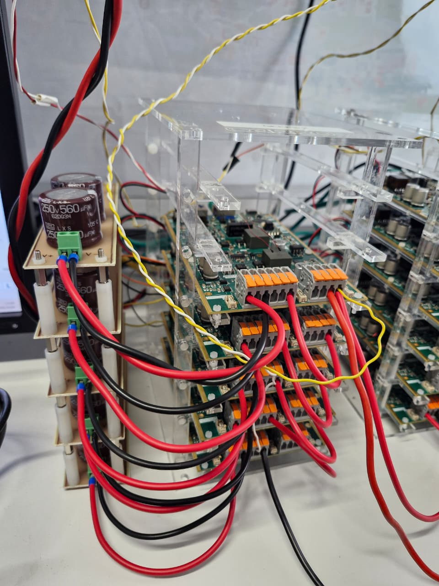

# Rack project for TWIST/SPIN boards

This project is a rack matching the size of the TWIST/SPIN boards, used to stack up to 7 boards. It keeps the boards aligned and spaced, with their power terminals and communication connectors accessible from the side.

The rack is made of transparent acrylic plates cut with a laser cutter, so the boards and their LEDs stay visible during the tests.

## Project file

| File | Content |
|---|---|
| [1Rack_20251007.svg](1Rack_20251007.svg) | Cutting drawing of all the rack parts, on a 500 mm × 400 mm sheet |

The drawing was made with Inkscape and is drawn at real scale (1 unit = 1 mm).

## Building the rack

1. Open `1Rack_20251007.svg` in Inkscape (or in the software of your laser cutter) and check that the sheet size is 500 mm × 400 mm, so the parts keep their real dimensions.
2. Export the drawing in the format used by your laser cutter (for example DXF or PDF).
3. Cut the parts in a 4 mm thick acrylic plate. The rectangular holes of the top and bottom plates (8.5 mm × 5.5 mm), where the tabs of the vertical pillars fit, are sized for this thickness. If you use plates of another thickness, adapt these holes before cutting.
4. Assemble the rack parts and place the TWIST/SPIN boards in the rack, one per level. To do so you need M2.5 and M4 screws and nuts, preferably in nylon.
