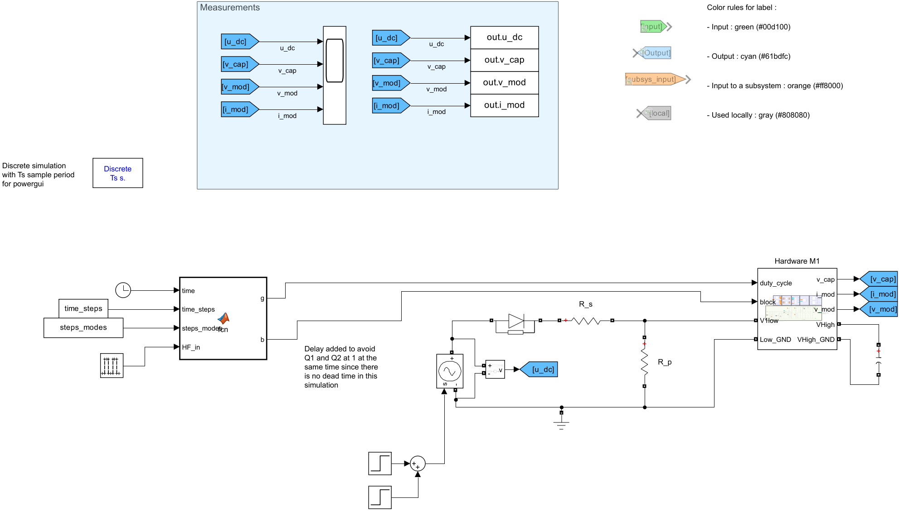
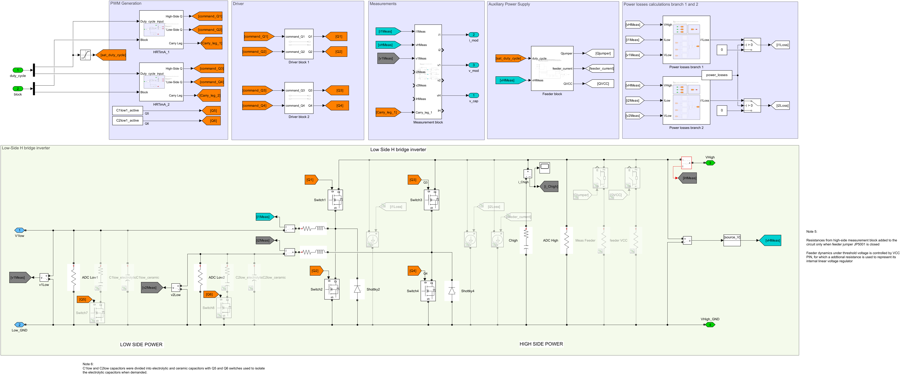

# Low-frequency test simulation of a TWIST-based MMC module

## Context

This simulation reproduces the low-frequency (LF) test of an individual MMC module, done experimentally with the [module test sequences code](../../../MMC_codes/Educational%20prototype/module_test_sequences/README.md). The module goes through its connected, disconnected and blocked states, with positive and negative currents.

The test circuit is shown below. The DC supply $u_{dc}$ feeds the module through a protection diode and the series resistance $R_s$. The resistance $R_p$, in parallel to the module, emulates negative currents that discharge the module capacitor once $u_{dc}$ is turned off.


The TWIST board is used as a half-bridge (HB) module of the MMC by deactivating its second leg (LEG2). The module capacitor is the high-side capacitor $C_{High}$ (VHigh to GND terminals).


The module states are set by the LEG1 switches:

| State | $Q1$ | $Q2$ | $v_{mod}$ |
|---|---|---|---|
| Connected | Closed | Open | $v_{cap}$ |
| Disconnected | Open | Closed | 0 |
| Blocked | Open | Open | $v_{cap}$ if $i_{mod} > 0$, 0 if $i_{mod} < 0$ |

The low-frequency sequence is the same as in the module test code:


## Simulink model

The model `MMC_1module_twist_LF_20261012.slx` represents the experimental test circuit:



- **Hardware M1**: TWIST board model programmed as a HB module (power switches, drivers, feeder, measurements and optional power losses). An extra capacitance $C_{M,extra}$ can be added on the VHigh terminals, as done experimentally.
- **Test circuit**: DC supply made of two steps (turned on at 0 s and off at `t_X`), protection diode, $R_s$ and $R_p$.
- **Sequence**: the `MATLAB Function` block reads the simulation time and applies the state of the current step of the sequence (`time_steps`, `steps_modes`). For the connected/disconnected step, it uses the pulse generator at `f_HF_test`. Its outputs are the Q1/Q2 commands (`g`) and block flags (`b`) of LEG1.
- **Measurements**: $u_{dc}$, $v_{cap}$, $v_{mod}$ and $i_{mod}$ are shown on a scope and saved to the workspace.

Inside Hardware M1, the TWIST board model:



## Inputs

The simulation is configured in `script_MMC_1module_twist_LF_20261012.m` and `test_parameters.m`.

- TWIST configuration:

```matlab
data_save = false; % true : save the simulation outputs in a .mat file
power_losses = false; % true : takes into account power losses from the MOSFETs
isInterleaved = false; % true : 180° phase shift between leg 1 and leg 2
isC1low1Active = false; % true : Q5 is closed (low-side electrolytic capacitor of LEG1 connected)
isC2low1Active = false; % true : Q6 is closed (low-side electrolytic capacitor of LEG2 connected)
is6VExternallySupplied = false; % true : 6 V external supply powers the auxiliary circuits / false : feeder is used
isFeederJumperOpen = false; % true : feeder disconnected from the board circuit (jumper JP5001 cut)
```

- Simulation configuration:

```matlab
latest_sim_name = 'MMC_1module_twist_LF_20261012.slx'; % Simulink model to execute
latest_test_parameters = "test_parameters.m"; % Test circuit parameters
latest_twist_parameters = "twist_parameters.m"; % TWIST parameters (from TWIST KiCad or obtained experimentally)
sim_time = 1; % [s] Overall simulation time
t_init_sim = -0.01; % [s] Simulation start time
Ts = 1e-6; % [s] Simulation sample period
```

- Sequence configuration, equivalent to the LF sequence of the module test code:

```matlab
t_X = 0.45; % [s] Time where VDC is turned off (start of the second part of the sequence, t_X >= 0.45 s)
f_HF_test = 50; % [Hz] Frequency of the connected/disconnected step

% Mode of each step: 0 = disconnected, 1 = connected, 2 = blocked, 3 = connected/disconnected at f_HF_test
% Step i goes from time_steps(i) to time_steps(i+1)
steps_modes = [ 2,  1,   0,   3,   0,   2,         1,         2];
time_steps  = [ 0,  0.1, 0.2, 0.3, 0.4, t_X+0.25,  t_X+0.35,  t_X+0.45,  sim_time];
```

The sequence can be changed freely: `time_steps` must have one more element than `steps_modes` (the end of the last step).

- Test circuit (`test_parameters.m`):

```matlab
VDC = 40; % [V] DC power supply voltage
R_s = R; % [Ohm] Series resistance
R_p = Rdec; % [Ohm] Parallel resistance discharging the capacitor
C_M_extra = 0; % [F] Extra capacitance in parallel to C_High (0 = no extra capacitor)
```

## Outputs

The results can be observed on the scope, or plotted from the simulation output variables:

```
out.u_dc  : DC power supply voltage
out.v_cap : module capacitor voltage
out.v_mod : module voltage
out.i_mod : module current
```

If `data_save` is true, the outputs are saved in the `sim_results` folder.

## Running the simulation

1. Clone this repository or download the `Module` folder.
2. In MATLAB, go to the `Module` folder.
3. Open `script_MMC_1module_twist_LF_20261012.m` and configure the simulation inputs.
4. Run the script. The simulation starts and its results appear on the scope.

## Expected results

The simulation can be compared with the experimental LF test results of the module test tutorial:


