# MMC phase simulations

## Context

These simulations reproduce the test of an MMC phase built with two stacks of 5 TWIST-based modules (10 modules), done experimentally with the [phase code](../../../MMC_codes/Educational%20prototype/phase_NLM_with_cvb/README.md). The upper and lower stacks are connected in series between the DC bus terminals, and the AC output is taken at their middle point.

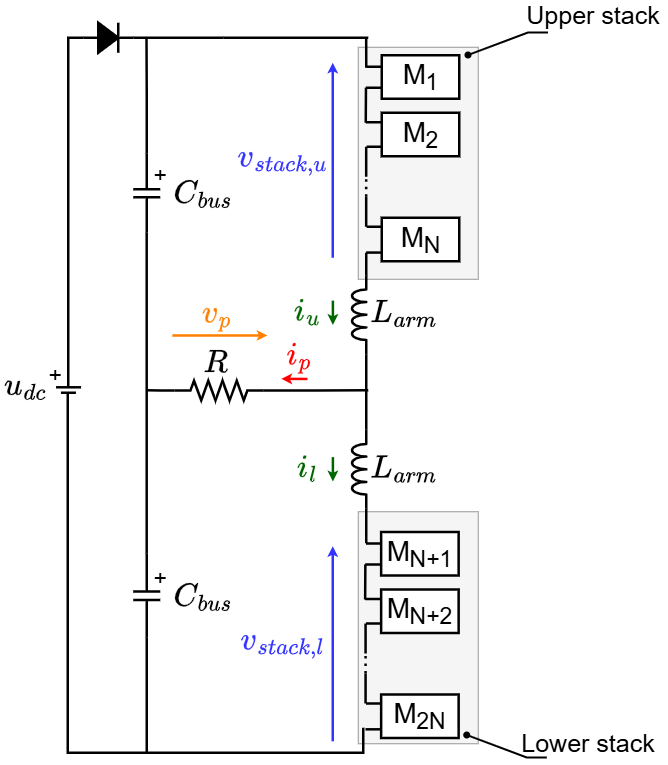

Each TWIST board is used as a half-bridge (HB) module of the MMC by deactivating its second leg (LEG2):


Three simulations are available, with the same hardware model and different control and communication strategies:

| Folder | Control | Communication |
|---|---|---|
| [Sim_NLM_centralized](Sim_NLM_centralized) | NLM + CVB executed by a supervisor (lead) board, which sends the gate commands to the modules | Ring communication between the modules and the supervisor |
| [Sim_NLM_discentralized](Sim_NLM_discentralized) | NLM executed in module M1; sorting and CVB executed in every module MCU | Ring communication between the modules |
| [Sim_PWM_consensus](Sim_PWM_consensus) | PWM modulation with a consensus algorithm between the modules of each stack | Not modeled (ideal exchange of information) |

## Open-loop control

The NLM modulation attributes to the modulation signal the nearest integer level using the function round. For example, if the modulation signal is 2.6, it is attributed to level 3. For the MMC, the modulation signal is a sinusoidal wave, so the NLM output is a stepped waveform that indicates how many modules should be connected in the upper and lower stacks ($N_{on,u}$ and $N_{on,l}$) according to time.


The CVB algorithm chooses which modules to connect in order to keep the capacitor voltages balanced. It makes its choice according to the measured capacitor voltages and the sign of the stack current, and generates the gate commands of the modules ($g_{M1}$, ..., $g_{M10}$): 1 (connected) or 0 (disconnected).


The modulation signals of the two stacks are phase-shifted by 180°, so $N_{on,u}$ and $N_{on,l}$ are phase-shifted by 180° as well and the phase voltage is centered in 0:

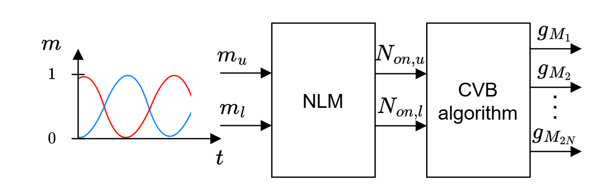

In the prototype, the measurements and the gate commands are exchanged over an RS-485 bus sequentially:


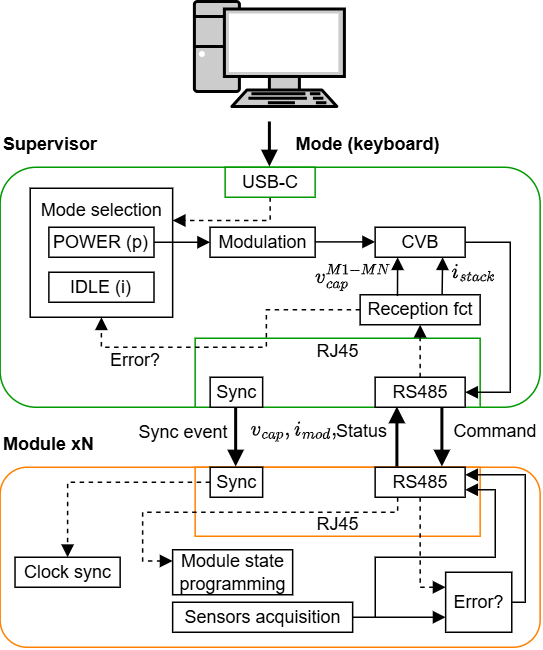


## Simulink models: hardware, communication and control

All the phase models are composed of three different parts: the power circuit, the communication between boards and the control algorithms are separate blocks connected together, as in the real prototype. The top level contains the MMC inverter and a monitoring subsystem, and the MMC inverter contains the three blocks. For the centralized NLM model:

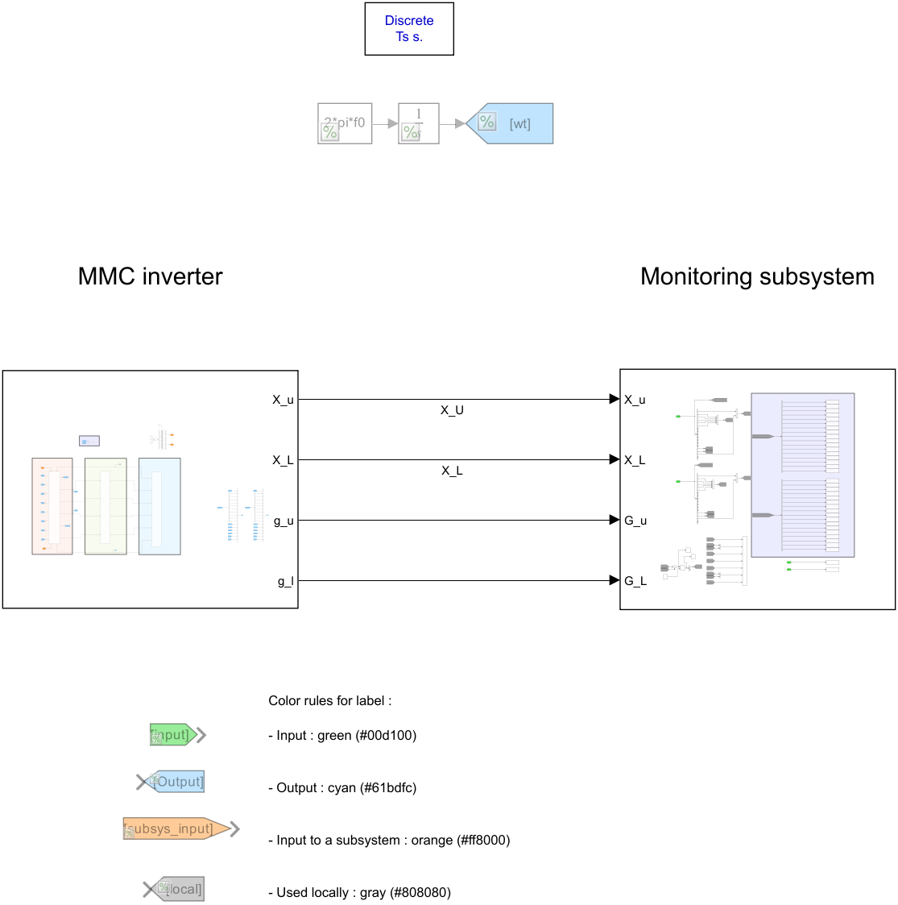

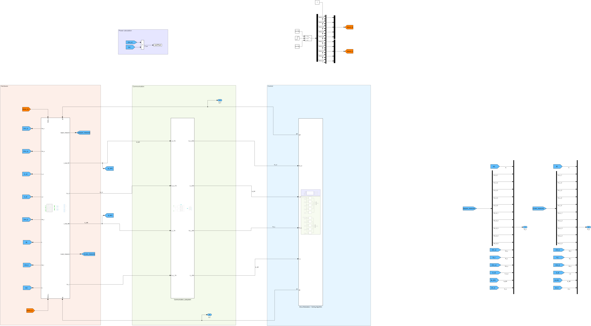

| Block | Content | Inputs | Outputs |
|---|---|---|---|
| **Hardware** | The 10 TWIST board models programmed as HB modules, the extra module capacitances, the arm inductances and the phase circuit (DC supply, DC bus capacitors, load) | Gate commands of the upper and lower stacks, block flags | Measured capacitor voltages, stack currents (measured by M1 and M6), stack and phase voltages and currents |
| **Communication** | Model of the ring communication: each module builds a frame with its capacitor voltage (and the stack current for M1 and M6), the frames are relayed from module to module with a delay `Tcom` per hop, and the receiver reads a snapshot of all the values | Values measured by the modules | Values as received by the control |
| **Control** | Modulation and balancing algorithms, executed in the supervisor and/or in the module MCUs depending on the model | Received capacitor voltages and stack currents | Gate commands of the modules |

The **Hardware** block:

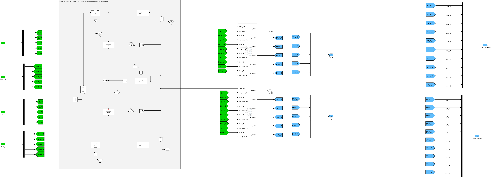

The **Communication** block:

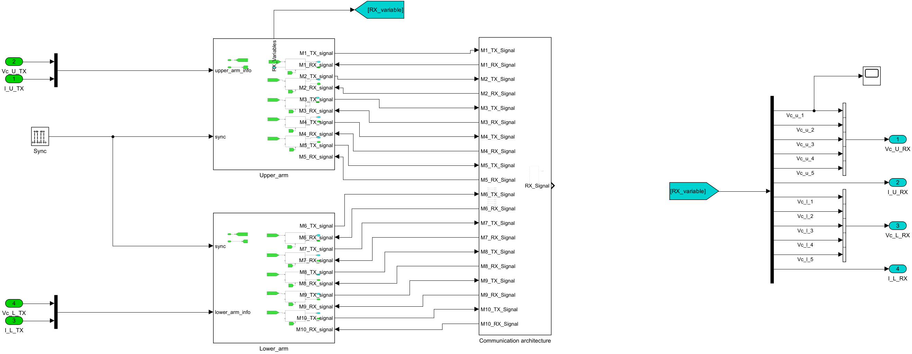

The communication is synchronized by a pulse every 200 µs (control period): a new communication round starts on its falling edge, and the received values (snapshot) are published on its rising edge. The values are quantized in the frames (0.1 V for the capacitor voltages, 0.1 A for the currents), as in the prototype.

### Control of each model

- **Centralized NLM**: the supervisor MCU computes the NLM and runs the sorting and CVB of each stack; each module MCU takes its own Q1/Q2 command from the supervisor output.

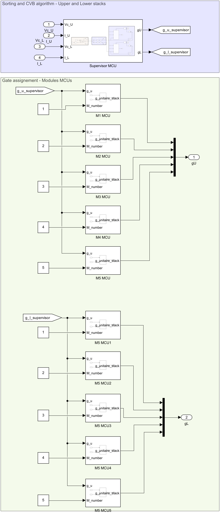

- **Decentralized NLM**: module M1 computes the NLM ($N_u$, $N_l$), and every module MCU runs the sorting and CVB with the received values to decide its own state.

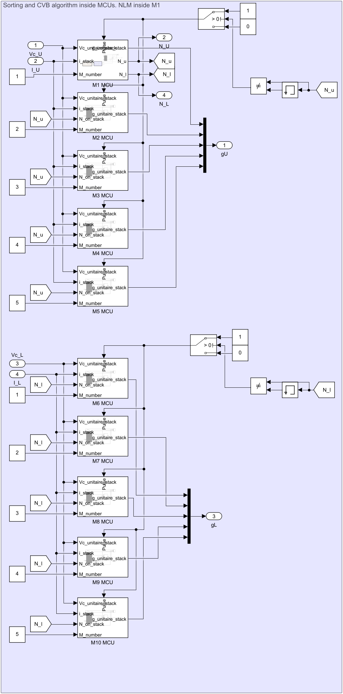

- **PWM consensus**: the modulation reference of each stack is followed by a PWM block with a consensus algorithm between the modules of the stack. This model has no communication block.

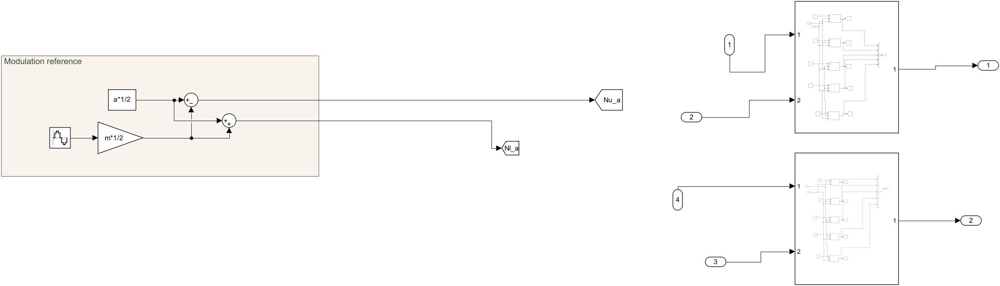

### Adapting the models

Since the blocks are separated, each one can be changed without touching the others, according to the application:

- **Hardware**: number of modules, module capacitance (`C_m`), arm inductance (`L_arm`), load (`R`), DC bus (`C_bus`, `VDC`), TWIST options (feeder, 6 V supply, low-side capacitors, power losses).
- **Communication**: communication time per hop (`Tcom`), synchronization period, frame format and quantization, number of nodes (`N_NODES` in the module transmitters), or a different topology. To simulate an ideal communication, the received values can be connected directly to the measured ones (as in the PWM consensus model).
- **Control**: modulation (NLM, PWM, ...), balancing algorithm, centralized or decentralized execution, as shown by the three models.

The **Monitoring** subsystem collects the signals saved to the workspace:

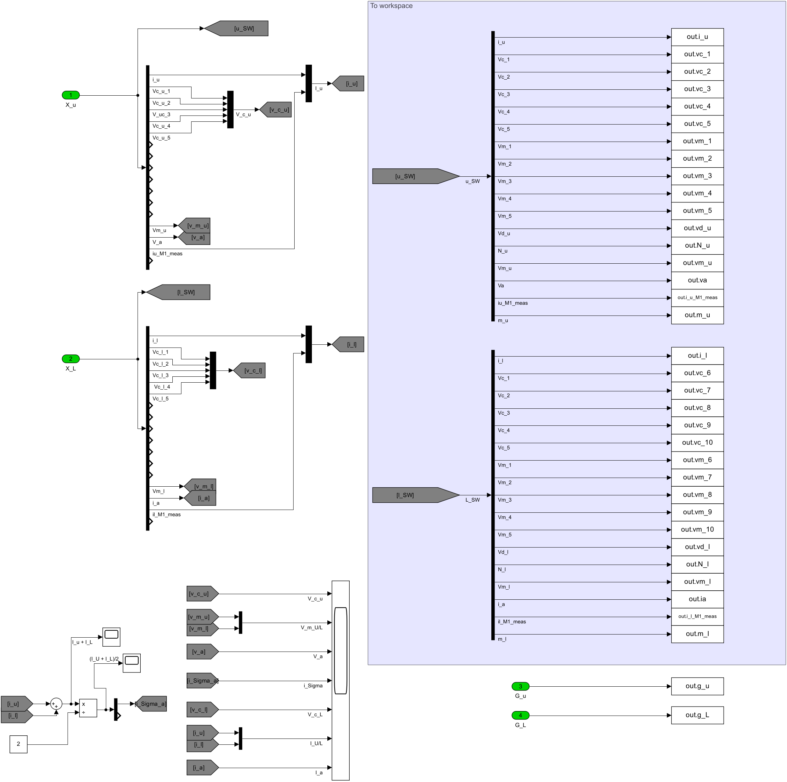

## Inputs

Each folder has its own script (`script_MMC_phase_hackathon_*.m`) with the same structure.

- TWIST configuration:

```matlab
data_save = false; % true : save the simulation outputs in a .mat file
power_losses = false; % true : takes into account power losses from the MOSFETs
isInterleaved = false; % true : 180° phase shift between leg 1 and leg 2
HaveChargingPhase = false; % true : capacitors charge passively until time_charge / false : capacitors start at VDC/N
isC1low1Active = false; % true : Q5 is closed (low-side electrolytic capacitor of LEG1 connected)
isC2low1Active = false; % true : Q6 is closed (low-side electrolytic capacitor of LEG2 connected)
is6VExternallySupplied = true; % true : 6 V external supply powers the auxiliary circuits / false : feeder is used
isFeederJumperOpen = true; % true : feeder disconnected from the board circuit (jumper JP5001 cut)
```

- Simulation configuration:

```matlab
latest_sim_name = '<model of the folder>.slx'; % Simulink model to execute
latest_twist_parameters = "twist_parameters.m"; % TWIST parameters (from TWIST KiCad or obtained experimentally)
sim_time = 1.5; % [s] Overall simulation time
t_init_sim = 0; % [s] Simulation start time
Ts = 1e-6; % [s] Simulation sample period (5e-7 s for the PWM consensus model)
time_charge = 0.1; % [s] End of the passive charging phase (if HaveChargingPhase = true)
time_decharge = 1.5; % [s] Time where VDC is turned off and the capacitors start to discharge
```

- Communication (NLM models):

```matlab
Tcom = 10e-6; % [s] Communication time per hop of the ring
Nnodes = 10; % Number of modules communicating
```

- Circuit and control:

```matlab
VDC = 48; % [V] DC voltage
f0 = 50; % [Hz] Modulation frequency
L_arm = 30e-3; % [H] Arm inductance (100e-3 in the PWM consensus model)
C_bus = 4400e-6; % [F] DC bus capacitance
R = 15; % [Ohm] Phase load resistance (30 in the PWM consensus model)
C_m = 1308.4e-6; % [F] Module capacitance (C_High + extra capacitance)
N = 5; % [-] Number of modules per stack
m = 1; % Modulation amplitude
a = 1; % Modulation DC part
f_control = 10e3; % [Hz] Control task frequency
```

## Outputs

The results can be observed on the scopes, or plotted from the simulation output variables:

```
out.i_u, out.i_l     : upper and lower stack currents
out.vm_u, out.vm_l   : upper and lower stack voltages
out.va, out.ia       : phase voltage and current
out.vc_1 ... vc_10   : module capacitor voltages (M1-M5 upper, M6-M10 lower)
out.vm_1 ... vm_10   : module voltages
out.vd_u, out.vd_l   : protection diode voltages
out.m_u, out.m_l     : modulation signals (NLM inputs)
out.N_u, out.N_l     : number of modules to connect (NLM outputs)
out.i_u_M1_meas      : upper stack current measured by M1 (used by the CVB)
out.i_l_M1_meas      : lower stack current measured by M6 (used by the CVB)
out.g_u, out.g_L     : gate commands of the upper and lower modules (NLM models)
out.Pout             : output power (NLM models)
```

If `data_save` is true, the outputs are saved in the `sim_results` folder.

## Running a simulation

1. Clone this repository or download the folder of the simulation.
2. In MATLAB, go to the folder of the simulation.
3. Open its `script_MMC_phase_hackathon_*.m` file and configure the simulation inputs. Check that `latest_sim_name` is the name of the `.slx` file of the folder.
4. Run the script.

## Expected results

The simulations can be compared with the experimental results of the phase test. The test result below considers NLM with CVB in centralized configuration.

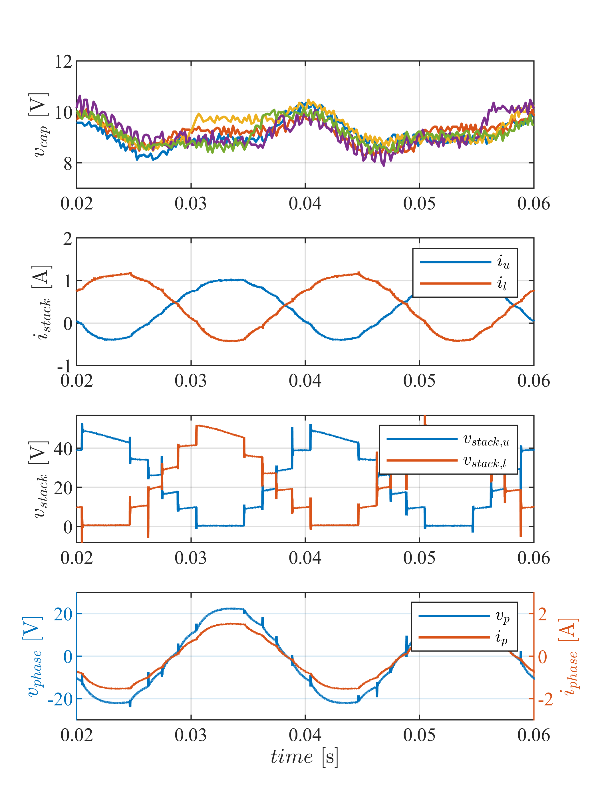
