# MMC stack simulation with NLM and CVB (centralized control)

## Context

This simulation reproduces the test of an MMC stack of 5 TWIST-based modules, done experimentally with the [stack with CVB code](../../../MMC_codes/Educational%20prototype/stack_with_cvb/README.md). The stack is controlled in open loop with Nearest Level Modulation (NLM) and a Capacitor Voltage Balancing (CVB) algorithm, executed by a supervisor (lead) board that communicates with the modules.

The test circuit is shown below. The DC supply feeds the stack through a protection diode and the series resistance $R_s$. The resistance $R_p$, in parallel to the stack, emulates negative currents that discharge the module capacitors.

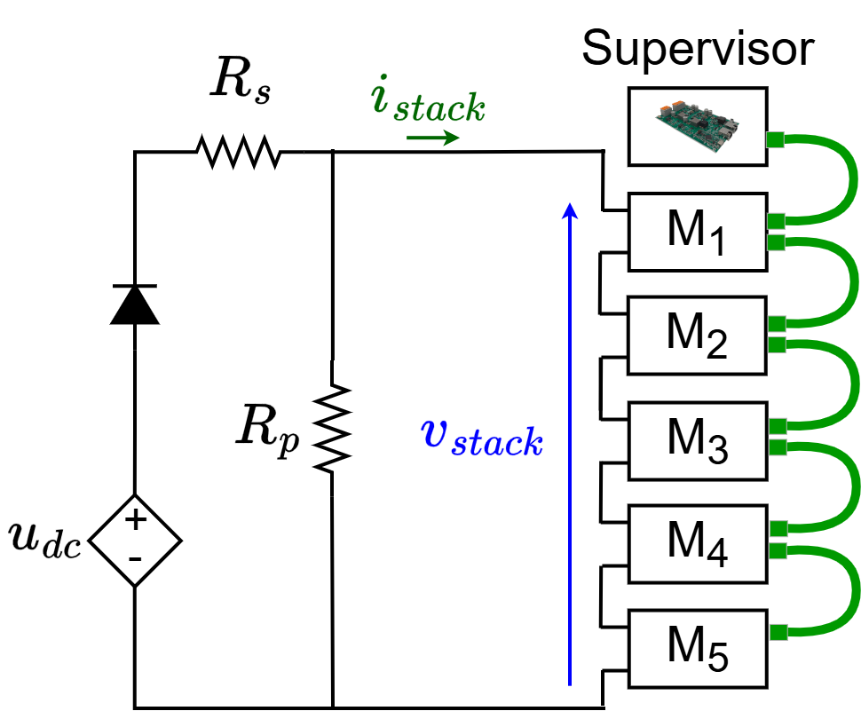

Each TWIST board is used as a half-bridge (HB) module of the MMC by deactivating its second leg (LEG2):

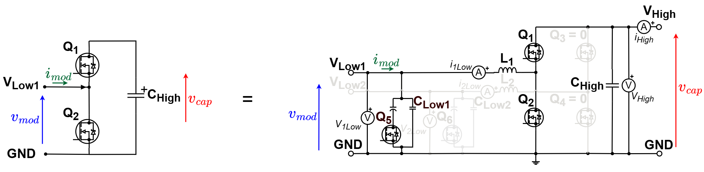

## Open-loop control

The NLM modulation attributes to the modulation signal the nearest integer level using the function round. For example, if the modulation signal is 2.6, it is attributed to level 3. For the MMC, the modulation signal is a sinusoidal wave, so the NLM output is a stepped waveform that indicates how many modules should be connected in the stack ($N_{on}$) according to time.

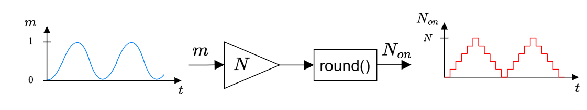

The CVB algorithm chooses which modules to connect in order to keep the capacitor voltages balanced. It makes its choice according to the measured capacitor voltages and the sign of the stack current, and generates the gate commands of the modules ($g_{M1}$, ..., $g_{M5}$): 1 (connected) or 0 (disconnected).


The complete open-loop control of the prototype:

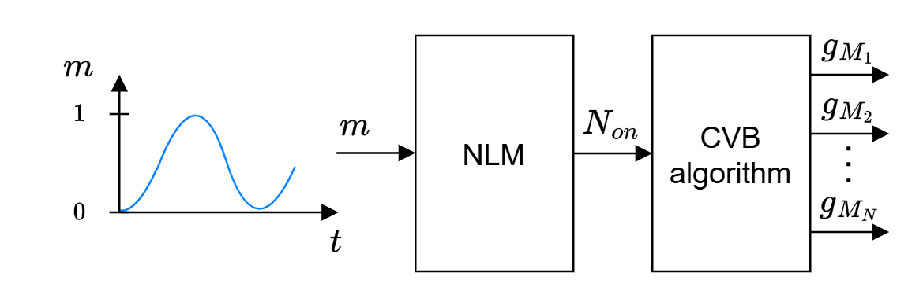

In the prototype, the capacitor voltages and the stack current are sent by the modules to the supervisor over an RS-485 bus, and the supervisor sends back the gate commands:


## Simulink model: hardware, communication and control

The model `MMC_stack_centralized_HAAS_20260927.slx` is a MMC model with three different parts: the power circuit, the communication between boards and the control algorithms are three separate blocks connected together, as in the real prototype. The top level contains the MMC inverter and a monitoring subsystem:

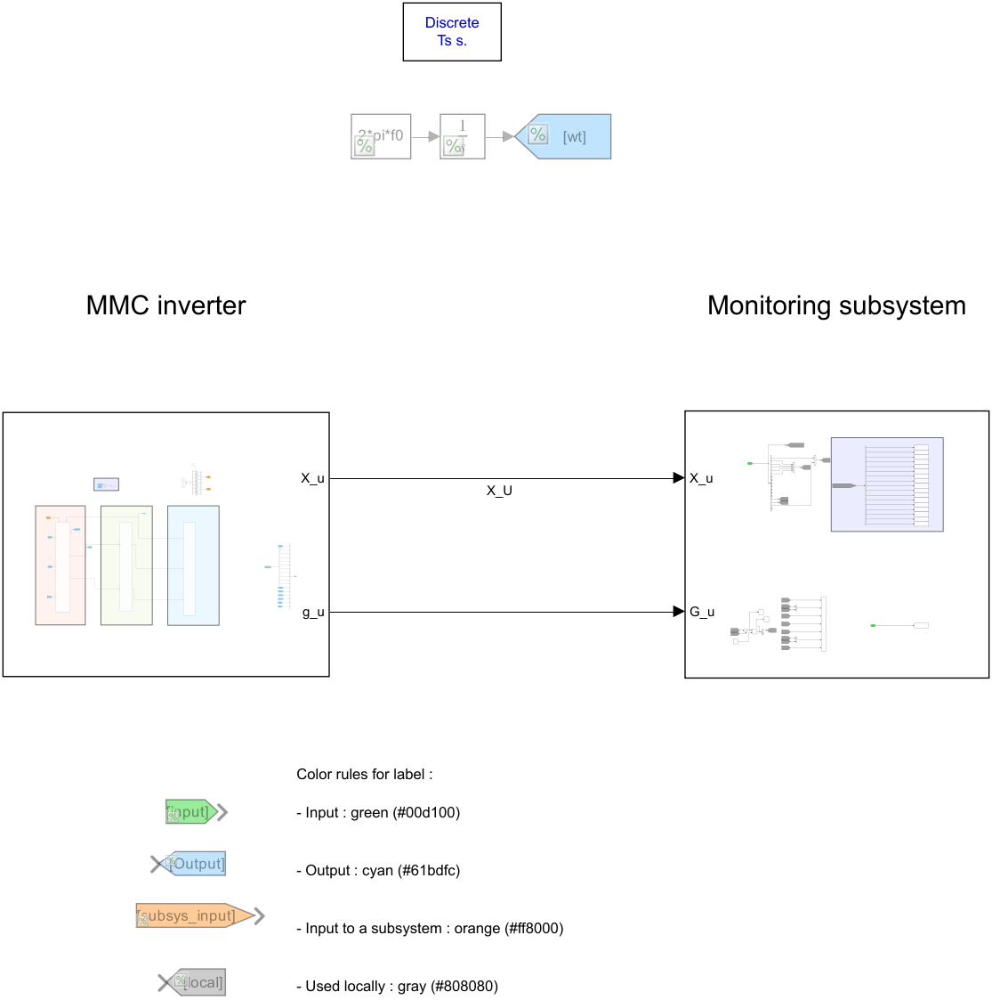

Inside the MMC inverter, the three blocks are:

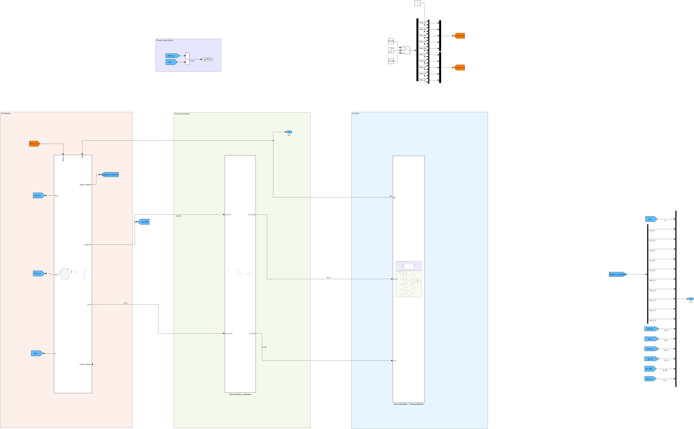

| Block | Content | Inputs | Outputs |
|---|---|---|---|
| **Hardware** | The 5 TWIST board models programmed as HB modules, the extra module capacitances and the test circuit (DC supply, diode, $R_s$, $R_p$) | Gate commands $g_u$, block flags | Measured capacitor voltages, module M1 current, stack voltage and current |
| **Communication** | Model of the communication between the modules and the supervisor: each module builds a frame with its capacitor voltage (and the stack current for M1), the frames are relayed from module to module with a delay `Tcom` per hop, and the supervisor reads a snapshot of all the received values | Capacitor voltages and stack current measured by the modules | Capacitor voltages and stack current as received by the supervisor |
| **Control** | Supervisor MCU (NLM + sorting + CVB) and module MCUs (each module takes its own Q1/Q2 command from the supervisor output) | Received capacitor voltages and stack current | Gate commands $g_u$ |

The **Hardware** block:

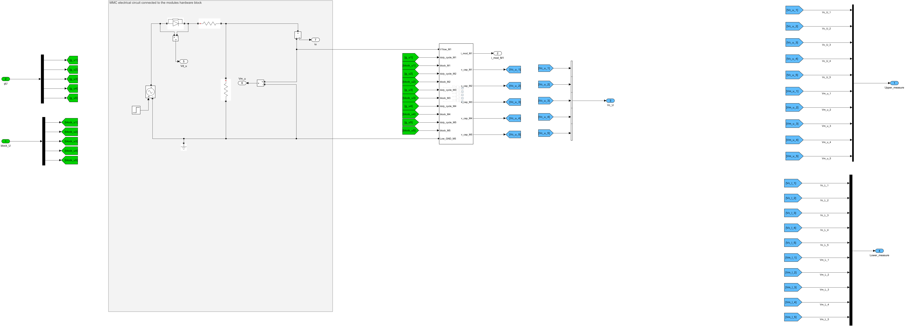

The **Communication** block:

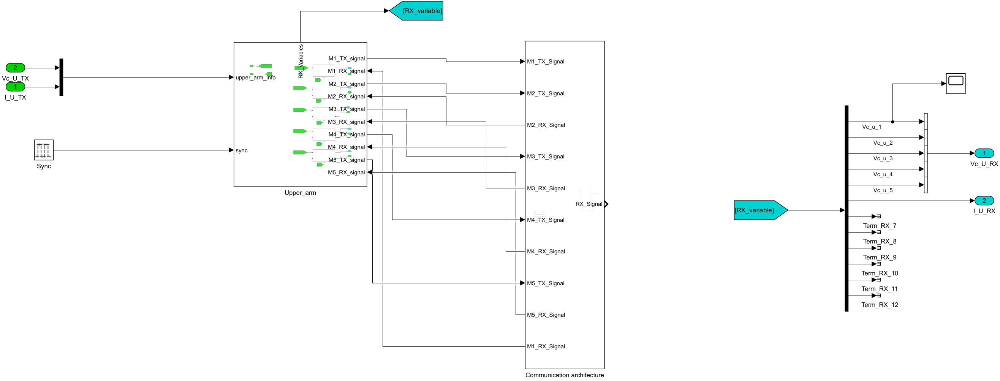

The communication is synchronized by a pulse every 200 µs (control period): a new communication round starts on its falling edge, and the supervisor publishes the received values (snapshot) on its rising edge. The values are quantized in the frames (0.1 V for the capacitor voltages, 0.1 A for the current), as in the prototype.

The **Control** block:

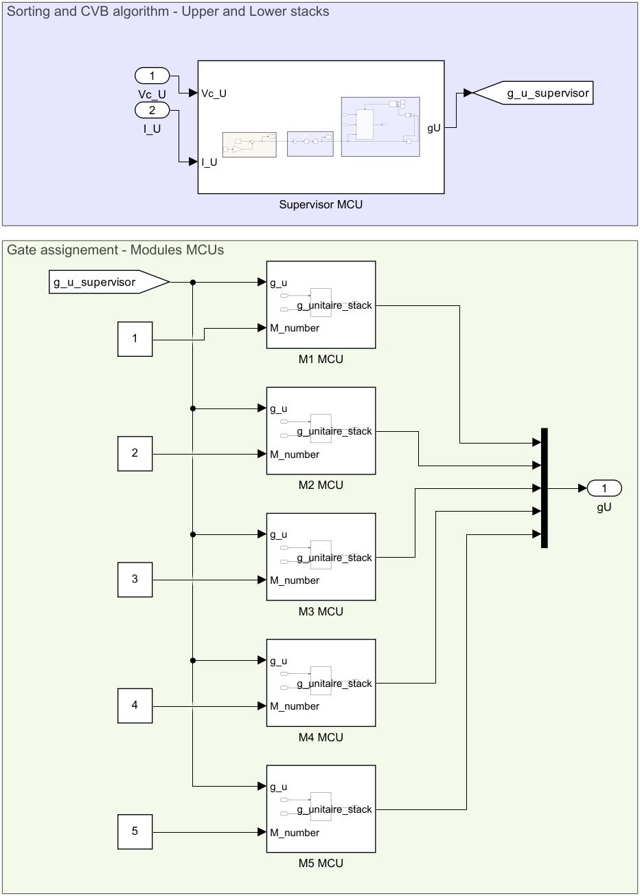

The CVB is executed only when the number of modules to connect $N_{on}$ changes. The supervisor output contains the Q1/Q2 commands of all modules ($[Q1_{M1}, Q2_{M1}, Q1_{M2}, Q2_{M2}, ...]$), and each module MCU takes its own pair.

### Adapting the model

Since the three blocks are separated, each one can be changed without touching the others, according to the application:

- **Hardware**: number of modules, module capacitance (`C_m`), test circuit (resistances, inductances, DC supply), TWIST options (feeder, 6 V supply, low-side capacitors, power losses).
- **Communication**: communication time per hop (`Tcom`), synchronization period, frame format and quantization, number of nodes (`N_NODES` in the module transmitters), or a different communication topology. To simulate an ideal communication, the received values can be connected directly to the measured ones.
- **Control**: modulation (NLM, PWM, ...), balancing algorithm (CVB, alternating order, ...), centralized or decentralized execution (see the [phase simulations](../Phase/README.md)).

The **Monitoring** subsystem collects the signals saved to the workspace:

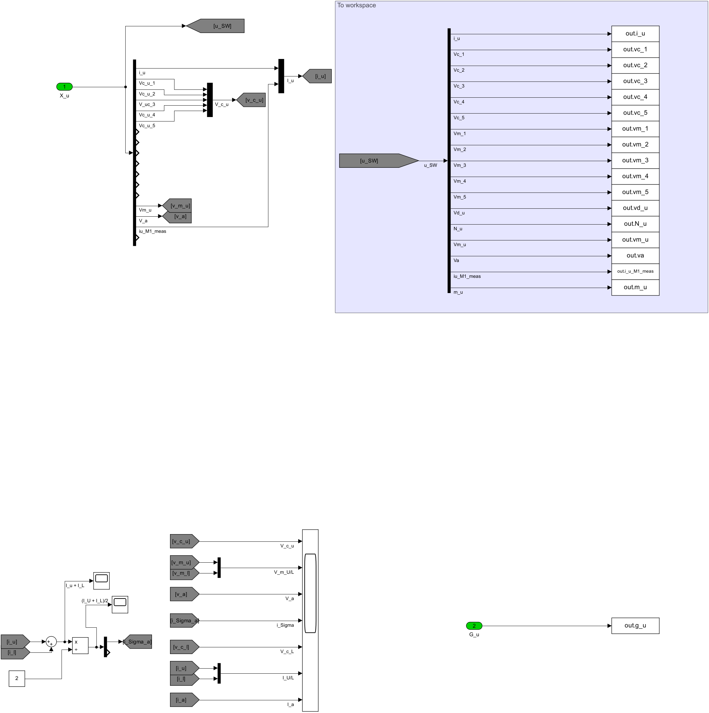

## Inputs

The simulation is configured in `script_MMC_stack_hackathon_NLM_centralized_HAAS_20260927.m`.

- TWIST configuration:

```matlab
data_save = false; % true : save the simulation outputs in a .mat file
power_losses = false; % true : takes into account power losses from the MOSFETs
isInterleaved = false; % true : 180° phase shift between leg 1 and leg 2
HaveChargingPhase = false; % true : capacitors charge passively until time_charge / false : capacitors start at VDC/N
isC1low1Active = false; % true : Q5 is closed (low-side electrolytic capacitor of LEG1 connected)
isC2low1Active = false; % true : Q6 is closed (low-side electrolytic capacitor of LEG2 connected)
is6VExternallySupplied = true; % true : 6 V external supply powers the auxiliary circuits / false : feeder is used
isFeederJumperOpen = true; % true : feeder disconnected from the board circuit (jumper JP5001 cut)
```

- Simulation configuration:

```matlab
latest_sim_name = 'MMC_stack_centralized_HAAS_20260927.slx'; % Simulink model to execute
latest_twist_parameters = "twist_parameters.m"; % TWIST parameters (from TWIST KiCad or obtained experimentally)
sim_time = 1.5; % [s] Overall simulation time
t_init_sim = 0; % [s] Simulation start time
Ts = 1e-6; % [s] Simulation sample period
time_charge = 0.1; % [s] End of the passive charging phase (if HaveChargingPhase = true)
time_decharge = 1.5; % [s] Time where VDC is turned off and the capacitors start to discharge
```

- Communication:

```matlab
Tcom = 10e-6; % [s] Communication time per hop of the ring
Nnodes = 5; % Number of modules communicating
```

- Circuit and control:

```matlab
VDC = 48; % [V] DC voltage
f0 = 50; % [Hz] Modulation frequency
R_s = 30; % [Ohm] Series resistance of the test circuit
R_p = R_s; % [Ohm] Parallel resistance of the test circuit
C_m = 1308.4e-6; % [F] Module capacitance (C_High + extra capacitance)
N = 5; % [-] Number of modules
m = 1; % Modulation amplitude
a = 1; % Modulation DC part
f_control = 10e3; % [Hz] Control task frequency
```

## Outputs

The results can be observed on the scopes, or plotted from the simulation output variables:

```
out.i_u          : stack current
out.vm_u         : stack voltage
out.vc_1 ... vc_5: module capacitor voltages
out.vm_1 ... vm_5: module voltages
out.vd_u         : protection diode voltage
out.m_u          : modulation signal (NLM input)
out.N_u          : number of modules to connect (NLM output)
out.g_u          : gate commands of the modules
out.i_u_M1_meas  : stack current measured by M1 (used by the CVB)
out.va           : voltage v_a of the circuit (V_a in the monitoring subsystem)
out.Pout         : power v_m_u * i_u
```

If `data_save` is true, the outputs are saved in the `sim_results` folder.

## Running the simulation

1. Clone this repository or download the `Stack` folder.
2. In MATLAB, go to the `Stack` folder.
3. Open `script_MMC_stack_hackathon_NLM_centralized_HAAS_20260927.m` and configure the simulation inputs.
4. Run the script.

## Expected results

The simulation can be compared with the experimental results of the stack test with CVB:

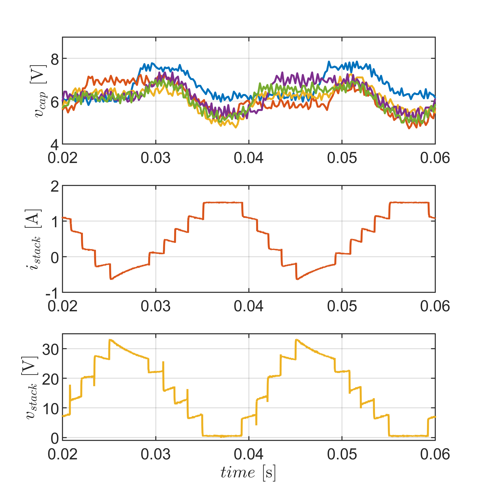
