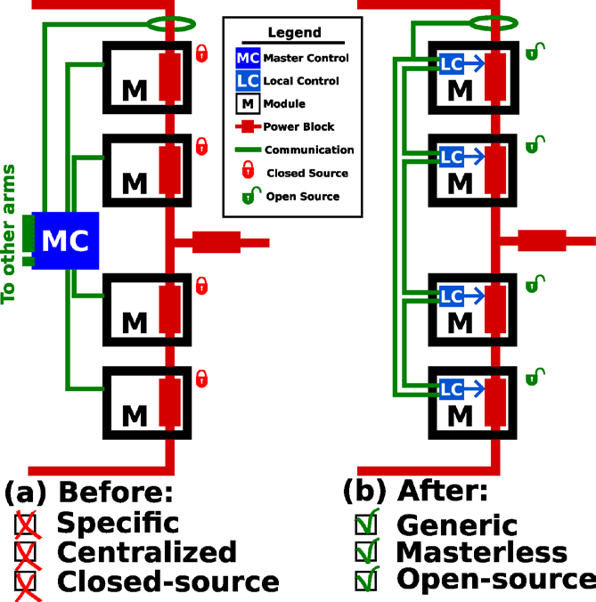
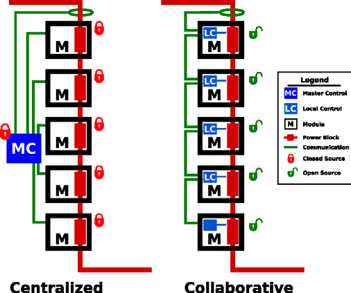
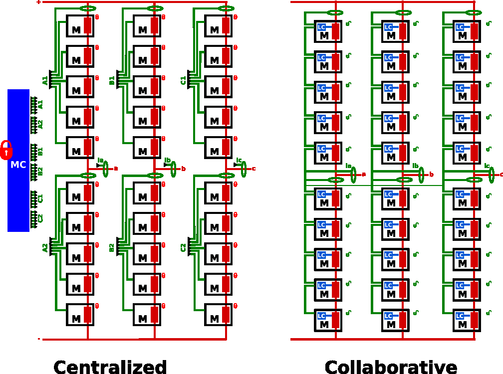

# CARROTS MMC

This repository contains the codes, simulation models and documentation of the open-source Modular Multilevel Converter (MMC) developed in the **CARROTS** project with [OwnTech](https://www.owntech.io/) suite.

The development of the project is followed in the [repository issues](../../issues), where you can find its latest updates.

## The CARROTS project

### Context

The energy transition is changing the electrical grid. More and more generation is connected locally to the medium-voltage (MV) grid, pushed by policies such as the French law that requires photovoltaic panels over parking lots larger than 1500 m². DC grids, and MVDC grids in particular, are a promising way to connect these sources and loads. Their main challenge is that they need **non-standard power converters**, which are expensive to design for each application.

The **Modular Multilevel Converter (MMC)** is a good candidate: it is standard, modular and scalable, since it is made of identical modules connected in series. However, its control and communication are complex. They usually rely on a centralized master controller that must measure and command every module. This controller is expensive and limits the use of MMCs in MV applications.

CARROTS proposes to replace the master controller by a local controller (LC) in each module, which communicate with each other:



*MMC with (a) a centralized control and data architecture and (b) a decentralized control and data architecture (expected outcome of CARROTS).*

### Objective

CARROTS aims to develop a **generic, masterless and open-source MMC**:

- **Generic**: reprogrammable modules that can be used as half-bridge (HB) or full-bridge (FB) modules, with distributed inductance.
- **Masterless**: the control is distributed between the modules, without a central controller.
- **Open-source**: the hardware and software are based on the OwnTech TWIST and SPIN boards, and are shared openly.

To reach this objective, the project addresses three scientific barriers, each one handled by a work package (WP), plus an integration WP:

| Work package | Barrier | Topics |
|---|---|---|
| **WP1 – Power** | Sizing and modeling the converter | Sizing of the modules, frugal digital twins |
| **WP2 – Control** | Controlling the MMC without a master | Cooperative distributed control |
| **WP3 – Data** | Exchanging data between the modules | Peer-to-peer real-time communication |
| **WP4 – Integration** | Building and testing the prototypes | Integration of power, control and data in the MMC prototypes |

The control is decentralized in two steps:

- **MMC V1**: a single arm of 5 OwnTech modules, where the control and data are decentralized inside the arm (intra-arm). The master controller is replaced by local controllers that collaborate.



*MMC V1: intra-arm control and data decentralization.*

- **MMC V2**: a three-phase MMC with 6 arms, where the control and data are also decentralized between the arms (cross-arm).



*MMC V2: cross-arm control and data decentralization.*

### Consortium

- GeePs (coordinator: Loïc Quéval)
- G2ELab
- LAAS-CNRS
- L2EP
- [OwnTech Technologies](https://www.owntech.io/)

The CARROTS project is funded by the French National Research Agency (ANR) under the grant ANR-24-CE05-0920-01.

## Repository content

```
MMC_OwnTech_Foundation
└─ MMC_codes                  Firmware of the MMC prototypes (PlatformIO projects)
|  └─ Educational prototype   Calibration, module tests, stack (with/without CVB) and phase tests
|  └─ Control logic           Standalone test of the NLM + sorting + CVB logic
|  └─ JCGE                    Codes of the 3rd OwnTech hackathon (JCGE)
|  └─ Other                   Blinky MMC stack and ScopeMimicry plot scripts
└─ MMC_documentation          Tutorials
|  └─ Getting started         Git/VS Code/PlatformIO and KiCad configuration
|  └─ Prototype tutorials     Step-by-step tutorials to build and test the prototype
|  └─ Others                  CVB logic and blinky MMC tutorials
|  └─ figures                 Figures used in the tutorials
└─ MMC_models                 MATLAB/Simulink models of the prototypes
|  └─ Educational prototype   Module, stack and phase simulations
|  └─ JCGE                    Models of the 3rd OwnTech hackathon (JCGE)
└─ schematics                 draw.io sources of the figures (hardware and communication)
└─>LICENSE.txt
└─>README.md
```

### MMC_codes

Each code folder is a PlatformIO project with its own README that explains the code and how to use it.

| Code | Description |
|---|---|
| [module_calibration](MMC_codes/Educational%20prototype/module_calibration/README.md) | Manual calibration of the TWIST sensors |
| [module_calibration_automated](MMC_codes/Educational%20prototype/module_calibration_automated/README.md) | Automated calibration of the TWIST sensors |
| [module_test_sequences](MMC_codes/Educational%20prototype/module_test_sequences/README.md) | Low-frequency (LF) and high-frequency (HF) test sequences of a single module |
| [stack_no_CVB](MMC_codes/Educational%20prototype/stack_no_CVB/README.md) | Stack of 5 modules with NLM and without capacitor voltage balancing |
| [stack_with_cvb](MMC_codes/Educational%20prototype/stack_with_cvb/README.md) | Stack of 5 modules with NLM and CVB |
| [phase_NLM_with_cvb](MMC_codes/Educational%20prototype/phase_NLM_with_cvb/README.md) | MMC phase of 10 modules (two stacks) with NLM and CVB |
| [Control logic](MMC_codes/Control%20logic/README.md) | NLM, sorting and CVB logic tested without power |
| [blinky_mmc_stack](MMC_codes/Other/blinky_mmc_stack/README.md) | First communication test between the boards of a stack |
| [scopemimicry_plot](MMC_codes/Other/scopemimicry_plot/README.md) | MATLAB/Python scripts to plot the ScopeMimicry data |

### MMC_documentation

The tutorials guide the user from the configuration of the computer to the test of an MMC phase:

1. [VS Code and Git configuration](MMC_documentation/Getting%20started/Vscode_for_OwnTech_configuration.md) and [KiCad configuration](MMC_documentation/Getting%20started/owntech_kicad_tutorial.md)
2. [Hardware modifications of the TWIST board for the MMC](MMC_documentation/Prototype%20tutorials/twist_modifications_MMC_tutorial.md), [module capacitor board](MMC_documentation/Prototype%20tutorials/KiCad_module_capacitor) and [rack](MMC_documentation/Prototype%20tutorials/Rack_project)
3. [Module calibration](MMC_documentation/Prototype%20tutorials/module_calibration_tutorial.md) (or its [automated version](MMC_documentation/Prototype%20tutorials/module_calibration_automated_tutorial.md))
4. [Module test sequences](MMC_documentation/Prototype%20tutorials/module_test_sequences_tutorial.md)
5. [Stack test with NLM without CVB](MMC_documentation/Prototype%20tutorials/stack_NLM_noCVB_test_tutorial.md) and [with CVB](MMC_documentation/Prototype%20tutorials/stack_NLM_CVB_test_tutorial.md)
6. [Phase test with NLM and CVB](MMC_documentation/Prototype%20tutorials/phase_NLM_CVB_test_tutorial.md)

Other tutorials: [plotting ScopeMimicry data](MMC_documentation/Prototype%20tutorials/scopemimicry_plot_tutorial.md), [CVB logic](MMC_documentation/Others/CVB_logic_tutorial.md) and [blinky MMC stack](MMC_documentation/Others/blinky_mmc_stack_tutorial.md).

### MMC_models

MATLAB/Simulink models of the TWIST-based prototype, which can be compared with the experimental results:

- [Module](MMC_models/Educational%20prototype/Module/README.md): low-frequency test of a single module.
- [Stack](MMC_models/Educational%20prototype/Stack/README.md): stack of 5 modules with NLM and CVB.
- [Phase](MMC_models/Educational%20prototype/Phase/README.md): MMC phase with centralized NLM, decentralized NLM and PWM with consensus.

The stack and phase models couple hardware, communication and control blocks, which can be adapted to the application.

## Getting started

1. Install [Git](https://git-scm.com/) and [VS Code with PlatformIO](https://platformio.org/install/ide?install=vscode), as explained in the [getting started tutorial](MMC_documentation/Getting%20started/Vscode_for_OwnTech_configuration.md).
2. Clone this repository:

   `git clone https://github.com/owntech-foundation/MMC.git carrots_mmc`

3. Clone the OwnTech Power API core project and open it in VS Code with `File > Open Folder...`. The application code goes in `src/main.cpp`, and the project is configured in `platformio.ini`.
4. Load the MMC codes in the project: in `platformio.ini`, replace the `owntech_examples` link with `https://github.com/analuhaas/examples.git`, then click on the PlatformIO icon and select the code under `Examples Twist` in the Project Tasks tab. The `main.cpp` files in [MMC_codes](MMC_codes) are the same codes, for reference.
5. Follow the tutorial of the code in [MMC_documentation](MMC_documentation).

For more information about the OwnTech Power API, see the [OwnTech documentation](https://docs.owntech.org/).

## License

See [LICENSE.txt](LICENSE.txt).
